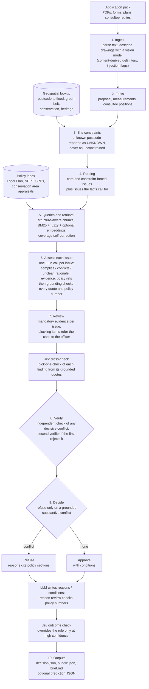

# Agentic Planning Assistant

Demo project that demonstrates an end-to-end agentic LLM system that drafts a decision on a housing planning application for Doncaster Council: **approve with conditions**, or **refuse with reasons** that cite the policy sections relied on. It reads a whole application pack (forms, consultee replies, statements and drawings, using vision on the drawings), checks the site's constraints, assesses each planning issue against retrieved national and local policy, and produces a decision plus an officer-facing audit brief.

It is built as a staged, cached pipeline rather than a free-roaming agent: deterministic code does the plumbing and rules, and an LLM is used only where judgement is needed. That keeps it cheaper, reproducible, testable and auditable. Every quote and policy number the model produces is checked against the source text, and a refusal is only issued when an independent check agrees on a grounded conflict.

> This is a demonstration project. The sample applications are fictional and the output is illustrative; it is not official planning advice. See [Disclaimer](#disclaimer).

## How a case is assessed



| Step | Module (`src/`) | LLM |
|---|---|---|
| Ingest: parse the pack, vision-describe drawings | `pipeline/ingest.py`, `pipeline/guard.py` | strong, vision |
| Facts and site constraints | `pipeline/facts.py`, `pipeline/site.py`, `pipeline/consistency.py` | cheap |
| Routing to planning issues (config in `configs/doncaster/issues.yaml`) | `pipeline/issues.py` | cheap, Jev |
| Search queries and policy retrieval | `policy/` | cheap |
| Assess each issue, then ground every citation | `pipeline/assess.py`, `pipeline/grounding.py` | strong |
| Review items, referral to the officer | `pipeline/review.py` | none |
| Verify decisive conflicts | `pipeline/verify.py` | cheap, Jev |
| Decide, write reasons and conditions, render the brief | `pipeline/decide.py`, `pipeline/brief.py` | strong, Jev |

"Refer to officer" is internal (`bundle.needs_officer` and a banner in the brief); the output JSON is always `approve` or `refuse`.

## Setup

Requirements: Python 3.12+ and [`uv`](https://docs.astral.sh/uv/getting-started/installation/).

```bash
uv sync
cp .env.example .env            # then set OPENROUTER_API_KEY
uv run pre-commit install --install-hooks   # optional: formatting hooks
```

Models are called through [OpenRouter](https://openrouter.ai/), which exposes an OpenAI-compatible API. Create an API key at <https://openrouter.ai/keys> and put it in `.env` (never commit `.env`). Model tiers default to Qwen via OpenRouter and can be overridden with `MODEL_CHEAP`, `MODEL_STRONG`, `MODEL_JUDGE`, `MODEL_VERIFIER2` (see `.env.example` and `src/config.py`). Optional [LangSmith](https://smith.langchain.com/) tracing is enabled with `LANGSMITH_TRACING=true`, `LANGSMITH_API_KEY` and `LANGSMITH_PROJECT`.

Check the key's remaining spend and expiry:

```bash
uv run --locked openrouter-status
```

## Commands

```bash
uv run parser                                   # PDFs -> data/extracted (text and images)
uv run assess case-006 --write-prediction       # assess a case, write predictions/case-006-prediction.json
uv run python scripts/eval_dev.py               # score the labelled eval cases (001-005)
uv run python scripts/eval_retrieval.py         # offline retrieval metrics, no API
uv run pytest && uv run ruff check src tests scripts && uv run mypy
```

`assess` options: `--run NAME` keeps a copy of the outputs under `outputs/runs/NAME/`; `--cache-only` never calls the API and fails on any uncached call; `--cheap-all` sends every stage to the cheap model; `--exclude DOC` leaves a document out of the pack (ablation). Every model reply is cached on disk (`.cache/`), so re-running an unchanged case costs nothing. Outputs go to `outputs/<case>/` (gitignored). The notebooks in `notebooks/` walk through the pipeline and diagnose a single case.

## Jev (optional decision model)

[Jev](https://openrouter.ai/) (`typesafe/jev-1.13` on OpenRouter) is a calibrated decision model: it returns a probability for yes/no questions and a distribution for pick-one questions, but cannot write prose, read images or do arithmetic. The pipeline uses it only where an LLM or a regex merely picks from a fixed set: document kind, optional-issue routing, injection scan, the second verifier, the cross-check of each assessment finding, the retrieval coverage gate and a final outcome check. It is **on by default**. When Jev is unsure (below a per-stage threshold) or errors, the original LLM or regex path runs, and the rule-based outcome is overridden only at confidence 0.9 or more.

- `JEV_STAGES` is a comma list of stages (`none` turns every stage off); `JEV_DECIDE=off|shadow|on` controls the final outcome check; `JEV_TAUS="stage=0.8"` sets per-stage thresholds.
- Jev replies are cached under `.cache/jev`. `--cache-only` therefore needs a Jev cache too; use `JEV_STAGES=none JEV_DECIDE=off` to replay a cache from before Jev.
- `scripts/eval_jev.py` replays stages to tune thresholds.

## Results

Measured on the five labelled eval cases (`data/doncaster/decisions`, cases 001-005) with the supplied evaluator, which pairs each generated reason with a reference reason using an LLM judge. Two configurations, which differ in model tier and in pipeline version, so they are not a controlled comparison:

| Configuration | Decisions | Reasoning F1 | Cost (5 cases) | Time per case |
|---|---|---|---|---|
| Current: every tier `qwen/qwen3.7-flash`, Jev on | 5/5 | 0.38 (precision 0.388, recall 0.390) | about $0.11 | 10.6 to 14 min |
| Strong model version | 5/5 | 0.60 | $2.39 | about 35 to 60 s |

Cases 006-010 are test cases with no reference decision; their outputs are in `predictions/` as examples.

## Data layout

- `data/national_policy`, `data/local_policy`: national and local planning policy and legislation (PDFs)
- `data/doncaster/applications`: sample planning applications grouped by `case-###`
- `data/doncaster/decisions`: reference decisions (`decision`, `reasons`, `conditions`) for cases 001-005
- `predictions`: example outputs for cases 006-010
- `data/extracted` (gitignored): parser output

The policy PDFs are official source documents; their licensing and attribution details are in [`data/LICENSING.md`](data/LICENSING.md). The sample application packs are inspired by real planning scenarios; identifying details and case characteristics are fictional.

Supporting components: a PDF parser (`src/parser`), the supplied evaluator (`src/evaluator`), and a hardcoded postcode-to-constraints lookup (`src/tools`, see its [README](src/tools/README.md)); unknown postcodes are reported explicitly rather than treated as unconstrained.

## Disclaimer

This project is not affiliated with, acting on behalf of, or endorsed by the UK Government, City of Doncaster Council, or any other public-sector body referenced in this repository. Public-sector documents are included solely to provide realistic context, subject to the terms described in [`data/LICENSING.md`](data/LICENSING.md). Any assessments, recommendations, or decisions it generates are illustrative and must not be treated as official planning advice or decisions.
